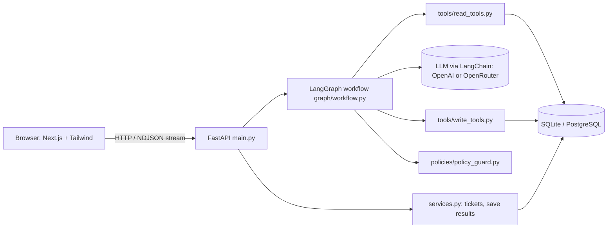
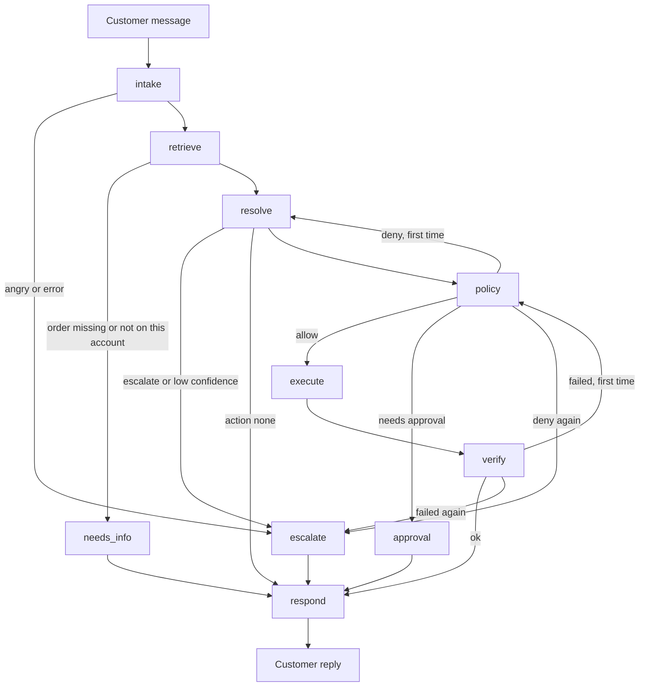
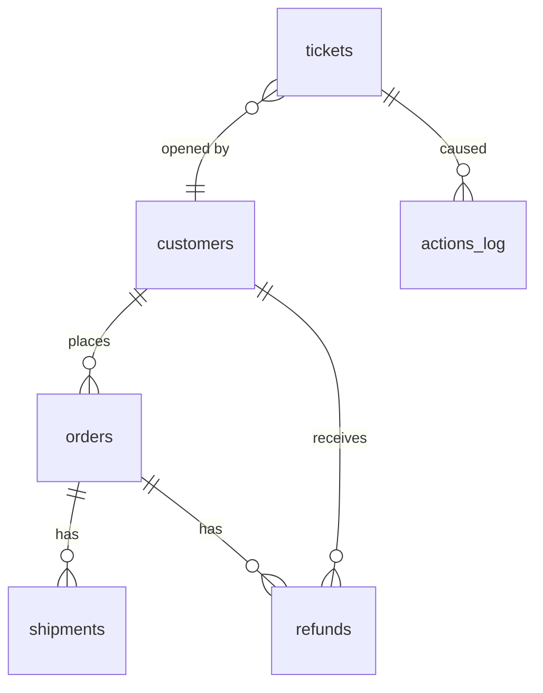

# System Architecture

ResolveFlow has three parts: a Next.js frontend, a FastAPI backend that runs one LangGraph workflow, and a SQL database.

## Who is allowed to do what

| Component | Uses LLM? | Can read DB? | Can write DB? |
|---|---|---|---|
| Intake | yes (structured output) | no | no |
| Context retrieval | no | yes (read tools) | no |
| Resolution | yes (structured output) | no (gets retrieved data in its prompt) | no |
| Policy Guard | no | no (gets order data) | no |
| Action Executor | no | no | **yes, the only one** |
| Verifier | no | yes | no |
| Escalation | no | no | no |
| Responder | yes (text) | no (gets verified facts only) | no |

## Workflow

## Database

